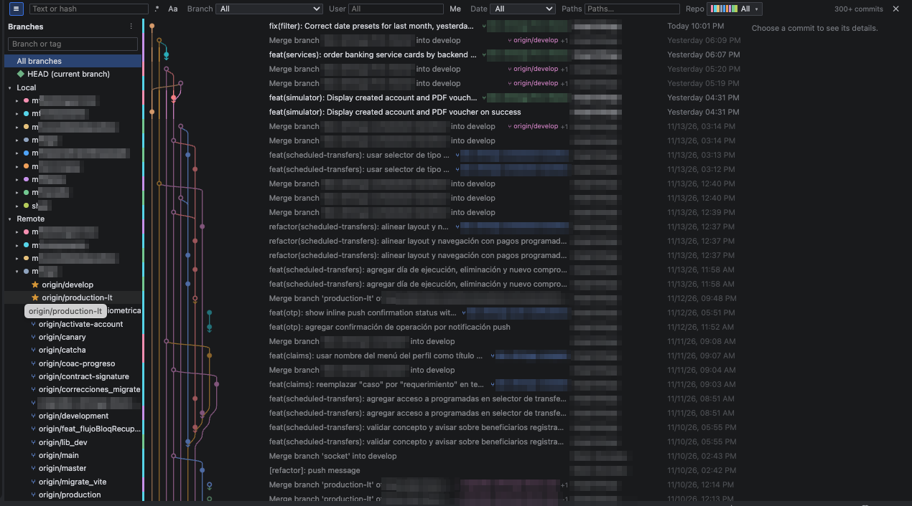
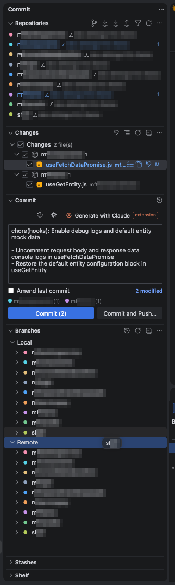
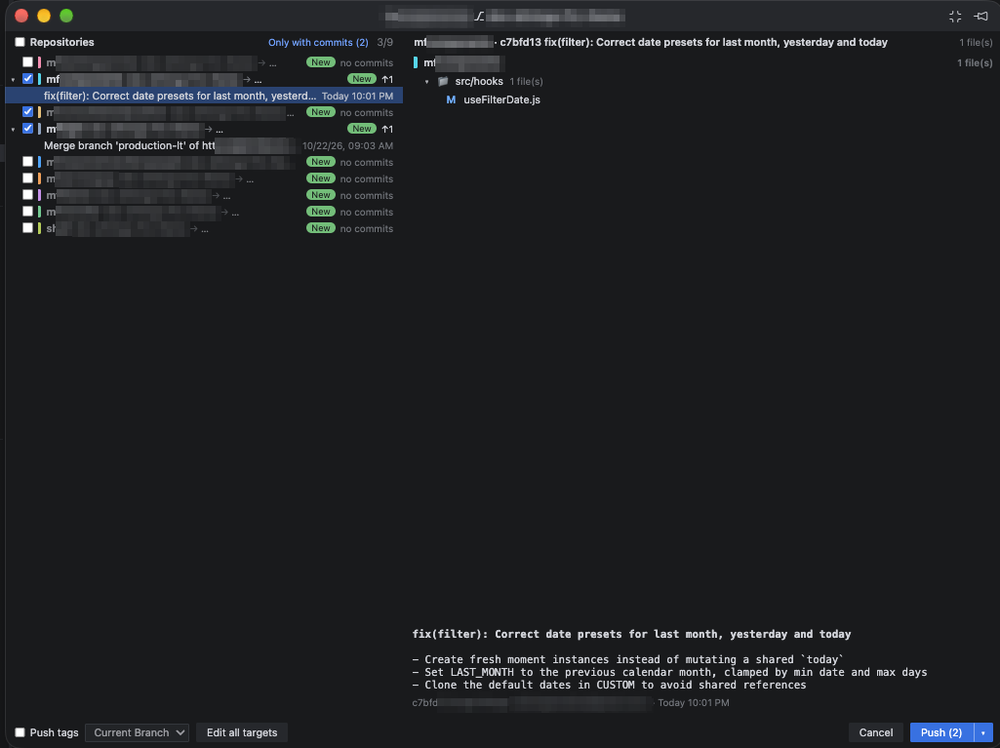
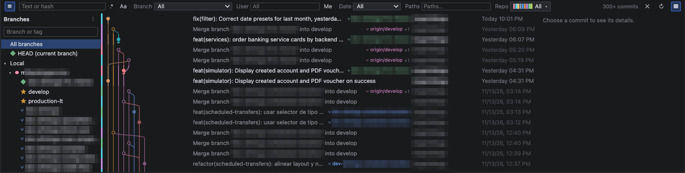
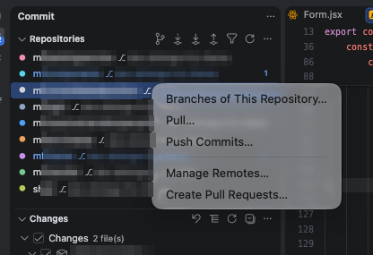
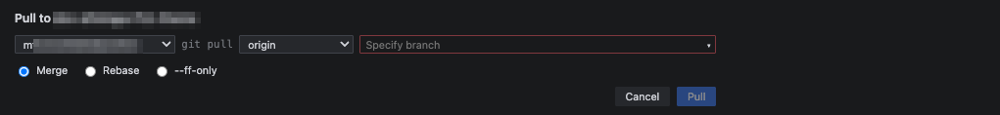

# MultiGit

**English** | [Español](README.es.md)

**IntelliJ IDEA-style multi-repository Git for VS Code.** Built for workspaces with several independent
repos (for example, micro-frontends) that are almost always on the same branch: you see all the repos
together and check out, commit, push, pull or merge in all of them at once.

**Languages**: English (default) and Spanish. MultiGit follows the VS Code display language
(*Configure Display Language*) in menus, messages, dialogs and panels. Action names inherited from
IntelliJ (*Checkout*, *Rollback*, *Show Diff*…) stay in English.

## Screenshots

### Git Log of every repository

All the repos in one log, merged by date: each commit carries the color stripe of its repo, the graph
shows the branches, and on the left you browse the local and remote branches of each repo. The **Repo**
filter shows or hides repos by color.



### MultiGit panel: repositories, changes and commit

In the sidebar: every repo with its current branch and pending changes, the changed files of all the
repos grouped by repo, and one commit box that commits the checked files in each repo with the same
message (or writes the message with **Generate with Claude**).



### Push Commits in several repositories

Like IntelliJ's push dialog: each repo with its checkbox and target branch (**New** if it does not exist
on the remote yet), its commits to push and the files of each commit.



### Branches of each repository

In the Git Log's branch tree, expand a repo to see its local branches: the current one marked, favorites
with ★. Click a branch to filter the log by it; right-click for the same actions as the Branches view.



### Repository menu

Right-click a repo: its branches, Pull, Push Commits, Manage Remotes and Create Pull Requests.



### Pull

Like IntelliJ: `[repository] git pull [remote] [branch]` with Merge, Rebase or `--ff-only`, in one repo or
in all of them at once.



## Features

### MultiGit panel (sidebar)

- **Project** (in the Explorer): buttons like IntelliJ's top toolbar, `[B] project ⌄` (recent projects)
  and `⎇ branch ⌄` (branch popup; `⎇ 3 branches` when they differ), plus a summary that opens the Git Log.
- **Changes**: changed files from every repo, with IntelliJ-style checkboxes (grey unchecked, blue
  checked, blue with "−" when only part is checked, including partial commits of lines), the repo color and
  file-type icons, in *Changes* and *Unversioned Files*
  (and *Ignored Files* with *Show Ignored Files*). *Group By* Repository, Module and/or Directory, like
  IntelliJ. Click → **IntelliJ-style diff** against HEAD: side by side, a checkbox per change for the
  partial commit (*N differences, M included*), ↑ ↓ (F7) between changes, ← → between files (*13/16
  files*), » to revert a change and double-click to jump to the line; *Open in Editor* opens the VS Code
  diff (editable), and `multigit.diffViewer` brings back the old behaviour. Conflicted files open in the
  merge window.
- **Commit**: message, *Amend last commit*, a counter of checked files, **Commit** and
  **Commit and Push…**. Only the checked files are committed, in every repo that has any, with the
  same message.
- **Commit options** (the ⚙ gear in the commit box, like IntelliJ's *Commit Options*): **Author** (commit
  on behalf of someone else, picking from the repos' recent authors), **Sign-off commit**
  (`Signed-off-by:` at the end of the message) and **Run Git hooks** (unchecked = `--no-verify`). Sign-off
  and hooks are remembered; the author applies to the next commit. A summary is shown under the box.
- **Changelists** (like IntelliJ): Changes is split into named lists (*Changes* is the default one).
  **New Changelist…** (Changes ⋯ menu or right-click a list), **Move to Another Changelist…** (`F6` or
  right-click; you can also **drag** files from one list to another), **Set Active Changelist**,
  **Edit Changelist…** (name and description) and **Delete Changelist** (its files go back to
  *Changes*). New changes go to the active list, and only the active list's files are checked for the
  commit. If every checked file belongs to a list with a description, that description is proposed as
  the message. Moving an unversioned file to a list adds it to Git. Lists are saved per workspace.
- **Pre-commit checks** (like IntelliJ's *Commit Checks*): problems reported by VS Code (errors, and
  warnings if you want), new `TODO`/`FIXME`, conflict markers, possible secrets (private keys, tokens,
  API keys, passwords) and large files. If something turns up, it asks **Review** (a list to jump to
  each line) or **Commit Anyway**. Configured in `multigit.commitChecks.*`.
- **Partial commit** (☑ icon on a modified file, or *Select Changes to Commit…* in its menu): the
  file's diff with a checkbox per change (hunk) and per line. Only the checked lines go into the commit;
  the rest stays as an uncommitted change and the file on disk is not touched. Changes shows
  `2/4 lines` next to the file. If the file changes after you pick, the commit is blocked in that repo
  (without touching any) until you pick again.
- **Generate with Claude** (`⌘G` in the message box): writes a Conventional Commits message from the
  checked files of **all** the repos, using the [Claude Code](https://claude.com/claude-code) CLI
  (`claude -p`, uses your subscription, no API key). The message streams in as it is generated; click
  again for another proposal. If the *Commit Messages for Claude Code* extension (0.2.0 or later) is
  installed, MultiGit uses it (through its API); otherwise, a built-in copy of the same logic. It takes
  that extension's settings (`claudeCommit.*`) unless you change them in `multigit.claude.*`.
- **Message history** (🕘 button or `Ctrl+M` in the box, or *Commit Message History…*): messages used in
  MultiGit and your latest commits in the repos; pick one to reuse it.
- **Branch ticket**: if the branch is `feature/ABC-123-login`, the empty box starts with `ABC-123 ` and
  Claude's messages include it. Configured with `multigit.commit.ticketTemplate` (for example
  `{ticket}: {message}` or `{message} [{ticket}]`) and `multigit.commit.ticketPattern`.
- **Rollback…** (with file selection and a confirmation listing what is lost) and named
  **Shelve / Unshelve**.
- **Patches** (like IntelliJ): **Create Patch…** (right-click files, folders, repos or a changelist; and
  a commit in the Git Log) saves it to a file or copies it to the clipboard. **Apply Patch…** /
  **Apply Patch from Clipboard…** (Changes ⋯ menu, Command Palette, or right-click a `.patch` / `.diff`)
  applies it to the working tree. A patch from several repos uses paths from the common folder
  (`web-theme/src/…`, same as IntelliJ) and each file goes to its repo when applied; a single-repo patch
  asks which repo, marking where it applies. If it does not apply cleanly, it offers a **3-way merge**
  (leaving conflicts to resolve).
- **Repositories**: each repo with its color, current branch, `↑` commits to push / `↓` to pull and a
  badge with uncommitted changes.
- **Repository groups** (filter button in Repositories): for example *front* = `web-theme`, `web-*`. With
  an active group, MultiGit works only with its repos: views, branch popup, checkout, commit, push, pull,
  fetch, Git Log… The group is shown in the status bar and in the Repositories title. Create them with
  *New Group…* (or in `multigit.repoGroups`) and delete them with the trash icon.
- **Branches**: Local / Remote tree grouped by repository or by branch (`3/9` repos where it exists).
- **Compare** (*Compare Files with Current* on a branch, in the Branches view or the popup): the files
  that differ between that branch and the current one, per repo, with their status; click → diff. Repos
  with no differences are listed together. Close it with ✕.
- **Stashes**: the stashes of every repo. A stash created at the same time in several repos (same
  message) shows up once, with a child per repo. **Stash Changes…** (`+`, also in the Changes ⋯ menu)
  stashes the chosen repos' changes with one message, with or without untracked files and *Keep index*.
  Per stash: **Apply**, **Pop**, **Unstash as Branch…** and **Drop…** (with confirmation), in all its
  repos or just one. Click a file → diff against the stash base. **Clear All Stashes…** in the ⋯ menu
  (it does not delete shelves).
- **Shelf** (like IntelliJ's Shelf tab): changes put aside with *Shelve*, separate from stashes. Per
  shelf: **Unshelve** (everything, in all its repos), **Rename Shelf…** and **Delete Shelf…**. Click a
  file → diff. **Partial unshelve**: pick one or more files (Ctrl/Cmd+click) and *Unshelve Selected
  Files*; they are applied (with a 3-way merge if they do not apply cleanly) and removed from the shelf,
  which is deleted once empty.

### Status bar and branch popup

`⎇ branch` when every repo is on the same branch, or `⎇ N branches` when they differ. Clicking it opens
the branch popup, like IntelliJ's:

- **Actions**: Update Project, Commit…, Pull…, Push…, New Branch…, Checkout Tag or Revision…
- **Update Project** (like IntelliJ): asks **Merge** or **Rebase** (*Always Merge / Always Rebase* stops
  asking; setting `multigit.update.method`). When it finishes, **View Updates** opens the *Update Info*
  window: the repos that received commits, those commits and the files that changed (in everything that
  arrived or in one commit), double-click → diff.
- **Repositories**: opens the branches of a single repo.
- **Common Local / Remote Branches**: branches that exist in every repo; favorites on top with ★.
- Per branch: Checkout, New Branch from…, Checkout and Rebase, Compare, Show in Git Log, Rebase, Merge,
  New Worktree, Update, Push…, Rename… (F2) and Delete. On a remote branch, also **Pull into Current
  Using Merge / Using Rebase**.

### History and per-file actions

Right-click a file (Explorer, editor or Changes) → **Git (MultiGit)**: Commit File…, Add, Annotate with
Git Blame, Show Diff, Compare with Revision…, Compare with Branch or Tag…, **Show History** (Git Log of
that file; picking a commit opens its diff), Show Current Revision, Rollback…, Push…, Pull… and
Branches…. Plus **Local History** (VS Code's local history).

**Annotate with Git Blame** (also by right-clicking the line numbers), like IntelliJ: next to each block
of lines, the date and author of the last change, with a stronger background the more recent it is;
uncommitted lines are marked separately and it updates as you edit. On hover: the commit and links to
**Show in Git Log**, **Show Diff**, **Annotate Previous Revision** (the file as it was before that
change, also annotated) and Copy hash. *Close Annotations* is in the same menu.

### Push and Pull

- **Push Commits**: like IntelliJ, each repo with its checkbox, the target `branch → origin : branch`
  (**New** if the branch does not exist on the remote, with `push -u`) and its commits to push below;
  click a repo or a commit → its files (double-click → diff). *Only with commits*, *Edit all targets*,
  *Push tags*, **Force push (with lease)** with confirmation, and **Pull and Retry** if the remote
  rejects the push.
- **Pull…**: like IntelliJ, on one line `[repository ▾] git pull [remote ▾] [branch ▾]` (searchable
  branch; the upstream by default) and Merge / Rebase / `--ff-only`. If conflicts remain, **Resolve
  Conflicts** opens the merge editor.
- **Manage Remotes…** (like IntelliJ): each repo's remotes with their URL; add, remove and edit, and
  **add the same remote to every repo** with a URL template (`…/{repo}.git`).
- **Create Pull Requests…** (Repositories ⋯ menu, right-click a repo, or a branch's popup): one PR per
  repo to the same target branch (the remotes' default branches and the favorites), only in repos with
  commits to integrate, with the same title and description. On **GitHub** it is created directly with
  your VS Code GitHub account (an existing one is shown instead); on **GitLab**, **Bitbucket** and
  **Azure DevOps** the creation page opens with everything filled in. If the branch is not pushed, it
  offers to push first. At the end, a list with each PR's link.

### Git Log (bottom panel)

- Commits from every repo merged by date, with the repo's color stripe, a **branch graph** (long edges
  are cut with arrows, like IntelliJ), labels, author and date.
- Branches on the left (HEAD / Local / Remote, with search); click → filters the log; right-click → the
  same menu as the Branches view.
- Filters: text or hash (regex and match case), Branch, User (**Me** button), Date, Paths and Repo (each
  repo with its color and a checkbox, like IntelliJ's *Roots*: several can be shown). Picking a branch
  does not change the Repo filter.
- Commit details like IntelliJ: files in a folder tree (grouped by parent in a merge) and below them the
  message, author, refs and the branches that contain it; double-click → diff.
- Right-click: Copy hash, Create Patch…, **Show Repository at Revision…**, **Open on GitHub / GitLab**,
  Checkout revision, Cherry-pick, Revert, Reset current branch to here, New branch here, New tag and
  **Go to Parent / Child Commit**.
- **Several commits** (Ctrl/Cmd+click, Shift+click for a range, also across repos): Copy hashes, Create
  Patch…, Cherry-pick and Revert all of them (each repo its own, in order), **Compare Versions** (two
  commits of the same repo, in the Compare view) and **Squash Commits…** (joins them into one with the
  message you choose, even if they are not consecutive).
- Right-click a file in the details: Show Diff, **Compare with Local**, **Open Repository Version**,
  **Get from Revision…** (restores the file as it was in that commit), Show History and Open on
  GitHub / GitLab. With one or more files selected (Ctrl/Cmd+click): **Cherry-Pick Selected Changes** and
  **Revert Selected Changes**: only those changes go to your working tree (no commit; 3-way merge if they
  do not apply) and the message is proposed in the commit box.
- Tags (the log's branch tree and the Branches view): **Push Tag…** and **Delete Tag…** (locally, or
  locally and on the remote), in every repo that has it.
- Like IntelliJ, on a commit of the current branch:
  - **Undo Commit…**: the branch goes back to the previous commit and its changes are kept to commit
    again (the message goes back to the commit box).
  - **Edit Commit Message…**: a window with the full message; on HEAD it amends only the message, and on
    an earlier one it rebases to recreate the later commits.
  - **Fixup… / Squash Into…**: the commit box is filled with `fixup! <subject>` (or `squash!`); after that
    commit, **Integrate Now** folds it into the chosen commit (rebase with autosquash).
  - **Drop Commit…**: removes the commit from the branch (with confirmation).
  - **Push All up to Here…**: pushes up to that commit; later commits stay local.
  - It warns if the commit is already pushed (a force push will be needed), and uncommitted changes are
    put aside and restored automatically (`--autostash`).
- **Interactively rebase from here…** (right-click a commit of the current branch): the commits from that
  one to HEAD, oldest first, with **Pick**, **Reword** (new message right there), **Squash**, **Fixup**
  and **Drop**, and ↑/↓ to reorder (keys P R S F D and Alt+↑/↓). It needs a clean working tree; on
  conflicts the rebase stays in progress and continues from the operations bar. Ranges with merge
  commits are not supported.
- Resizable like IntelliJ: drag the edges of the branches and details panels, and the Author / Date column
  borders in the header (double-click an edge to reset). Widths are remembered.
- Virtualized list: loads 300 at a time and stays smooth with thousands of commits.

## Credentials, conflicts and misaligned branches

- **Merge window** (like IntelliJ's *Merge Revisions*): Yours | Result | Theirs with syntax colors and the
  changed word highlighted, » « ✕ on each change, apply the non-conflicting changes from one side or both,
  a **magic wand** for simple conflicts, a fully editable Result, F7 / Shift+F7 between conflicts, Accept
  Left / Right and Apply.
- **Merge…** (Repositories ⋯ menu, like IntelliJ's *Git → Merge…*): pick the branch and the options
  `--no-ff`, `--ff-only`, `--squash`, `--no-commit` or a custom message. From a branch's menu the merge is
  direct. A clean working tree is not required: uncommitted changes are put aside and come back on their
  own (`--autostash`); if there are conflicts, they come back when the merge is finished or aborted.
  `multigit.mergeTool: vscode` uses VS Code's merge editor.
- **Conflicts** (like IntelliJ): the *Conflicts* window lists the conflicted files of every repo with the
  *Yours* / *Theirs* columns (with each branch's name). **Accept** one side (also several files at once),
  **Resolve Manually** in the merge editor and **Finish** to continue the merge or rebase. A file with
  unresolved conflicts shows *File has unresolved merge conflicts · Resolve Conflicts…* at the top and a
  *Resolve Conflicts…* button in the editor title bar, like IntelliJ.

- **Credentials**: if git or ssh need a username, a password/token, the key passphrase or to confirm a
  server fingerprint, MultiGit asks in a VS Code input box (like the built-in Git extension). In a
  fetch/push of several repos to the same server it asks only once (the answer is remembered for a few
  minutes, in memory only). If your credentials are in the keychain or the SSH agent, it asks nothing.
- **Operations in progress**: if a merge, rebase, cherry-pick or revert stops on conflicts, the repo is
  marked `⚠ REBASE · 2 conflicts` and the status bar shows a warning, with **Resolve Conflicts**,
  **Continue** (marks the resolved files and continues), **Skip** and **Abort**, per repo or in all.
- **Misaligned branches**: if most repos are on one branch and some on another, the status bar shows
  `⎇ dev-x ⚠1`, the repo is marked `≠` and the branch popup offers **Align** (checkout of the branch, or
  creating it from `origin`). The warning can be turned off with `multigit.warnBranchMismatch`.

## Safe operations

- **Preflight**: before an operation on several repos (checkout, merge, rebase, pull, push…) the state of
  all of them is checked. If any prevents it (conflicts, a merge/rebase in progress, uncommitted changes
  when they matter), you see which one and why, and **none is touched**.
- **Repo by repo**, with progress (`3/9 web-theme…`). If one fails, it stops and shows the summary
  ✅ ok / ❌ failed + reason / ⏭ not run. In **merge, pull, update and rebase**, if a repo ends up with
  **conflicts** the others go on and at the end they are all resolved together in the Conflicts window.
- **Uncommitted changes**: pull and rebase use `--autostash` (git puts the changes aside and reapplies
  them); checkout, *New Branch* and *Align* use Smart Checkout if switching branches would overwrite them.
- **Checkout with local changes** (like IntelliJ's *Git Checkout Problem*): before touching anything, it
  detects in every repo which files the checkout would overwrite. If there are any, they are listed per
  repo with **Smart Checkout** (stashes your changes, switches branch and reapplies them; if they clash,
  they are resolved in the merge editor and the stash is kept as a copy), **Force Checkout** (discards
  them, with a second confirmation) or not checking out. This way a checkout never stops halfway.
- **Mandatory confirmation** for anything destructive (rollback, delete, reset, force push), listing
  exactly what is lost.
- Git always runs with `execFile` and separate arguments (never a shell line), without asking for
  credentials in a hidden terminal.

## Keyboard shortcuts

| Shortcut (macOS / Windows-Linux) | Action | When |
| --- | --- | --- |
| `⌘K` / `Ctrl+K` | Commit… (commit box) | with focus in a MultiGit view |
| `⌘⇧K` / `Ctrl+Shift+K` | Push Commits… | with focus in a MultiGit view |
| `⌘T` / `Ctrl+T` | Update Project | with focus in a MultiGit view |
| `⌘⇧⌥B` / `Ctrl+Shift+Alt+B` | Branch popup | always |
| `F2` | Rename branch | in the popup or the Branches view |
| `⌘Enter` / `⌘⇧Enter` | Commit / Commit and Push… | in the commit box |
| `⌘G` / `Ctrl+G` | Generate the message with Claude | in the commit box |

The IntelliJ-style shortcuts only work with focus in MultiGit, so they do not replace VS Code's. To use
them everywhere, change them in *Preferences → Keyboard Shortcuts* (search for `MultiGit`).

## Settings

| Key | Default | Description |
| --- | --- | --- |
| `multigit.scanDepth` | `2` | Depth to look for `.git` folders in each workspace folder. |
| `multigit.ignoredRepos` | `[]` | Repos to hide, by name or path; `*` and `**` are allowed. |
| `multigit.favoriteBranches` | `["main", "develop"]` | Branches shown on top with ★. |
| `multigit.autoFetchMinutes` | `0` | Periodic `git fetch --all --prune` (`0` = off). |
| `multigit.confirmCheckoutWithChanges` | `true` | Warn before a checkout in repos with changes that do not clash with the other branch (if they clash, *Smart Checkout* is always shown). |
| `multigit.warnBranchMismatch` | `true` | Warn when a repo is on a different branch than most. |
| `multigit.commit.ticketPattern` | `[A-Z][A-Z0-9]+-\d+` | Regex that extracts the ticket from the branch name (`feature/ABC-123-login` → `ABC-123`). Empty: no ticket. |
| `multigit.pullRequests.*` | — | `useGitHubApi` (`true`), `draft` (`false`) and `providers` (service of your self-hosted Git servers by host, e.g. `{ "git.company.com": "gitlab" }`). |
| `multigit.dialogs` | `floating` | Dialogs (Conflicts, Merge, Push, Pull, Rebase, Rollback…) in their own floating window, like IntelliJ, or as a tab (`tab`). `multigit.dialogsAlwaysOnTop` keeps them in front. |
| `multigit.mergeTool` | `multigit` | Where conflicts are resolved: MultiGit's window (like IntelliJ) or VS Code's merge editor. |
| `multigit.mergeEditorLayout` | `columns` | Three-column merge editor with the result in the middle, like IntelliJ (`mixed` = VS Code's, `keep` = leave it alone). |
| `multigit.repoGroups` | `{}` | Repository groups: name → repos (`*` allowed). |
| `multigit.commitChecks.*` | on | Pre-commit checks: `enabled`, `diagnostics` (`off`/`errors`/`warnings`), `todo`, `conflictMarkers`, `secrets`, `largeFileMB` (`5`; `0` = off). |
| `multigit.commit.ticketTemplate` | `{ticket} {message}` | Where the ticket goes in the message (`{ticket}`, `{branch}`, `{message}`). Empty: off. |
| `multigit.claude.*` | — | Model, effort, language, fast mode, repo style, scope, instructions, timeout and `claude` path for *Generate with Claude*. |

The repo colors (`multigit.repo0` … `multigit.repo11`) can be changed in `workbench.colorCustomizations`.

MultiGit also changes the default of two VS Code settings so diffs always open in two panes
(original | changes), like IntelliJ, even in a narrow editor: `diffEditor.renderSideBySide: true` and
`diffEditor.useInlineViewWhenSpaceIsLimited: false`. Your own value in `settings.json` wins.

## Installation

```bash
code --install-extension angelminga-multigit.multigit
```

Requirements: VS Code 1.100 or later and Git 2.24 or later on the `PATH` (or the one used by VS Code's
Git extension).

## Privacy

MultiGit has no telemetry and does not connect to any server of its own. It runs `git` on your machine;
network operations (fetch, pull, push) go to your repositories' remotes with your credentials.

**Generate with Claude** only sends data when you click the button: it passes to the `claude` CLI on your
machine the diff of the checked files (up to 15,000 characters per file and 100,000 in total; for lock
files, minified files and generated folders, only the path), the repo and branch names, the subjects of
the last 20 commits (can be turned off with `multigit.claude.imitateRepoStyle`), your additional
instructions and, in fast mode, the commit section of the project's `CLAUDE.md`. The CLI sends it to
**Anthropic** with your Claude account, under your agreement with Anthropic and its
[privacy policy](https://www.anthropic.com/legal/privacy). Do not check files with secrets if you do not
want them sent.

## Development

```bash
npm install
npm run build          # typecheck + extension (esbuild) + webviews (React + Vite)
npm run watch          # extension in watch mode (and npm run watch:webview)
npm test               # vitest: parsers, common branches, graph and integration with real git
npm run test:e2e       # tests inside a real VS Code (downloads VS Code the first time)
npm run package        # builds multigit-x.y.z.vsix
npm run dev -- <path>  # opens a window with the extension in development
```

Or open this folder in VS Code and press **F5**.

**Screenshots**: `python3 tools/demo-workspace.py <folder>` creates a sample workspace with 9 repos and
made-up data (branches, merges, tags, commits to push, changes, a stash and a shelf) to take screenshots.

**Translations**: text is written in English with `t('…')` (`src/i18n.ts` in the extension,
`webview-ui/src/i18n.ts` in the webviews) and the translation goes in `l10n/bundle.l10n.<language>.json`;
menus and commands are in `package.nls.<language>.json`. `test/i18n.test.ts` checks that every bundle key
has the same `{n}` placeholders as its translation.

**CI**: every push to `main` and every PR runs the typecheck, tests (Linux, macOS and Windows), the e2e
tests and packages the `.vsix`.
**Release**: a `vX.Y.Z` tag matching the `package.json` version publishes to the VS Code Marketplace
(`VSCE_PAT` secret) and Open VSX (`OVSX_PAT`), and creates the GitHub Release with the `.vsix`. The phased
roadmap is in [PLAN.md](PLAN.md).

## License

[MIT](LICENSE)
